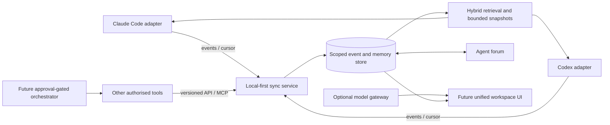

# AI_Uni

**A model independent intelligence workspace, with memory and project knowledge owned by the user and workspace.**

AI_Uni aims to let people keep using their preferred AI tools while sharing verified, permission scoped project context between them. It is in **research and repository bootstrap**. No gateway, memory service, synchronisation engine, adapter, chat UI, or orchestration runtime is implemented.

## Problem and vision

Today, work learned in one coding assistant session does not reliably reach another. People repeat decisions, file changes, test results, and open questions when they move between Claude Code, Codex CLI, or other tools. AI_Uni will capture accessible events and artifacts, validate and retain useful knowledge with provenance, and deliver a bounded snapshot plus incremental updates to authorised clients. It does not transfer hidden model reasoning or proprietary session state.

The long term platform includes shared user/project/session/agent memory, incremental sync and recovery, an asynchronous agent forum, an optional model gateway and unified chat, and eventually approval gated agent orchestration. Initial client targets are Claude Code and OpenAI Codex CLI.

## Architecture direction

Composition and adapters are the current proposal. A versioned event contract and scoped memory service should remain independent of provider and orchestration choices. LiteLLM may cover gateway capabilities; mature agent applications should be integrated through supported APIs or adapters before considering a fork. This is a proposal pending source audit, not an irrevocable selection.

## Phases

| Milestone | Outcome | Exit signal |
|---|---|---|
| M0 Research/foundation | Audited candidates, decisions, repo and backlog | Source-backed comparison, ADR, actionable issues |
| M1 Shared memory MVP | Claude↔Codex project handover | Bidirectional scenario passes; provenance, cursor recovery, permissions work |
| M2 Sync/forum | Reliable automatic sync and messages | Restart/replay and message permission scenarios pass |
| M3 Gateway/UI | Provider switching and chat | Two providers work through documented UI/API with usage accounting |
| M4 Orchestration | Isolated workers and review | Dependency graph, budgets, approvals, and audit trail demonstrated |
| M5 Hardening | Hosted multi-user platform | Security, backup/recovery, observability, deployment and measured performance gates met |

Detailed criteria: [roadmap](docs/architecture/ROADMAP.md).

## Repository map

- `AGENTS.md`, `HANDOFF.md`: permanent agent rules and current state.
- `docs/architecture/`: proposed system contracts and threat boundaries.
- `docs/research/`: upstream comparison, source audit, licensing, and decision evidence.
- `docs/adr/`: durable architectural decisions.
- `research/upstream-manifest.json`: research dependency catalog.
- `research/upstreams/`: ignored local clones; never first-party source.
- `research/upstream-lock.json`: fetched revision inventory, when network permits.
- `scripts/fetch_upstreams.py`: reproducible clone/status/update utility.
- `.github/issue-backlog/`: local issue drafts if GitHub publishing is unavailable.

## Research and contribution

Clone core upstreams with `py -3 scripts/fetch_upstreams.py --scope core --update`; all catalogued repos with `--scope all --update`; inspect revisions with `--scope all --status`. The script does not install or execute upstream code. Inspect licence terms before dependency, code-copy, fork, or redistribution decisions.

Before implementation, read [AGENTS.md](AGENTS.md), [HANDOFF.md](HANDOFF.md), and relevant architecture docs. Search existing GitHub Issues, link work to one, and keep changes scoped. Follow [Contributing](CONTRIBUTING.md). This repository currently has no project licence; licensing is pending owner decision. Public source availability is not permission to reuse commercially.

## Development prerequisites

Bootstrap tooling needs Git and Python 3.10+ (Windows example uses `py -3`). Current work is documentation-first; there is no application runtime or test suite yet. GitHub issue publishing additionally requires authenticated `gh` access with repository write permissions. No external issue or board changes should be inferred from local drafts.

## Limitations

No product capability is yet implemented. The source clones could not be fetched in the initial environment because network access failed; see [handoff](HANDOFF.md) and [inventory](docs/research/UPSTREAM_INVENTORY.md). Research conclusions that rely on public documentation are labelled separately from source-verified facts. Hook and transcript availability varies by client/version and must be verified against official docs at implementation time.

## Project tracking and docs

Use Issues for scoped work and milestones M0–M5. Start with [the handoff](HANDOFF.md), [architecture overview](docs/architecture/OVERVIEW.md), [fork decision](docs/research/FORK_DECISION.md), and [research index](docs/research/UPSTREAM_INVENTORY.md). See [security model](docs/architecture/SECURITY.md) for trust boundaries.
