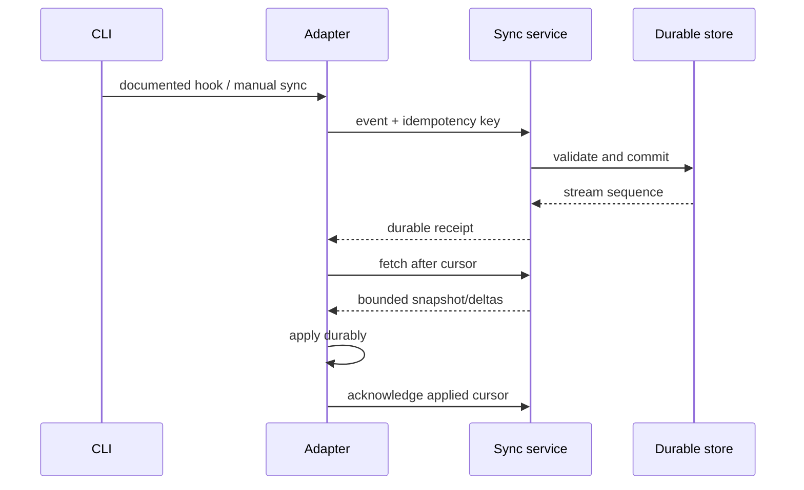

# CLI integration

**Status: targets and research questions only.** Claude Code and Codex CLI are initial clients. Use documented hooks, CLI APIs, app-server protocols, MCP, or explicit manual commands where available. Do not assume hook parity, transcript access, event completeness, or stable undocumented filesystem formats.

An adapter should declare client/version, capabilities, hook availability, transcript/artifact permissions, delivery guarantees, manual sync commands, local state/cursor storage, and limitations. Capture only user-authorised, accessible events/artifacts. Treat hooks as best-effort triggers; reconcile against supported source APIs/artifacts and preserve idempotency. Never claim to restore hidden chain of thought or provider-owned state.

Planned research: verify Claude Code hooks and session access against official docs; Codex CLI and app-server protocol, approval/permissions model, and event surfaces against official docs. Test version compatibility before declaring support. Adapter output maps to canonical event contract and sends via authenticated local service.

