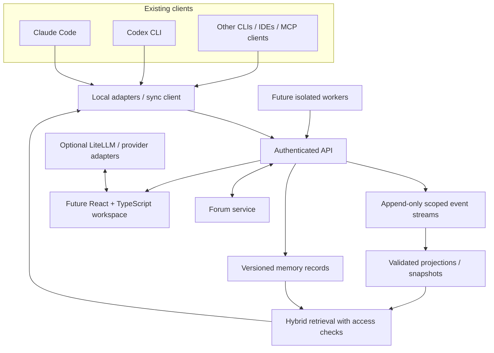

# Architecture overview

**Status: proposed, not implemented.** Product architecture has six separable concerns: provider gateway, scoped intelligence/memory, incremental synchronization, agent forum, user interface, and later orchestration. The memory/sync contracts are the durable core; provider and runtime adapters are replaceable edges.

Start local-first, with a single deployable service and SQLite for local development; PostgreSQL is the preferred shared deployment store. Avoid premature microservices. A potential gateway should be integrated, not duplicated. Security boundaries, schemas, and API contracts precede service extraction.

## Boundaries

- **Adapters** gather only accessible/authorised events and publish idempotently; clients own native execution.
- **Event store** gives stable identity, ordered per-stream records, and transactional acknowledgement.
- **Memory** stores claims with scope, provenance, versions, confidence and validity; generated claims remain untrusted pending validation.
- **Retrieval** enforces permissions before ranking and returns citations/source references within budgets.
- **Forum** stores typed, scoped asynchronous communication. Message content never outranks system policy.
- **Gateway/UI/orchestrator** are later optional consumers of contracts, not owners of project truth.

## Quality attributes

Durability, replay, idempotence, bounded context, deletion propagation, tenant isolation, model portability, observability without logging secrets, and deterministic contract tests. See `EVENT_MODEL.md`, `MEMORY.md`, and `SECURITY.md`.
